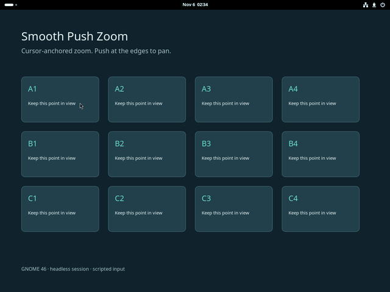
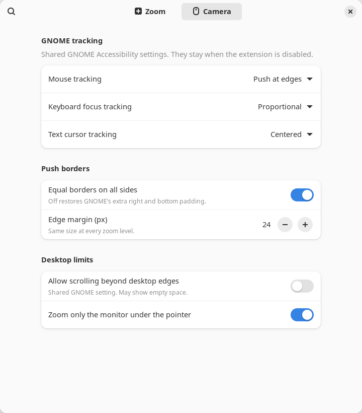

# Smooth Push Zoom

Smooth desktop zoom for GNOME Shell 46. Hold **Super + Alt** and scroll.



- The zoom follows the wheel or touchpad continuously instead of in steps.
- The content under the cursor stays where it is while zooming.
- GNOME's mouse tracking keeps working, including **Pushes Contents Around**.
  Push starts at the same distance from every edge (24 px by default).
- With more than one monitor, only the monitor under the pointer is zoomed.
- Zooming back to 1.00× turns Desktop Zoom off.

## Install

Download `smooth-push-zoom@jinkim0823.github.io.shell-extension.zip` from the
[latest release](https://github.com/jinkim0823/smooth-push-zoom/releases/latest), then:

```sh
gnome-extensions install --force smooth-push-zoom@jinkim0823.github.io.shell-extension.zip
gnome-extensions enable smooth-push-zoom@jinkim0823.github.io
```

On Wayland a newly installed extension is loaded at the next login. To install
from a source checkout, run `./install.sh`.

## Settings



| Setting | Default | |
| --- | --- | --- |
| Shortcut | Super + Alt | Modifiers held while scrolling |
| Zoom speed | 0.12 | About 12.7% per wheel step |
| Smoothing | 90 ms | Time to reach about 95% of a change; 0 is immediate |
| Maximum zoom | 12× | |
| Responsive pointer | On | Update the magnified pointer every frame |
| Equal borders | On | Same Push margin on all four edges |
| Edge margin | 24 px | Distance from the edge where Push starts, at any zoom |
| Zoom only the monitor under the pointer | On | Multi-monitor setups |

The tracking modes and "Allow scrolling beyond desktop edges" on the Camera
page are GNOME's own accessibility settings. Changes to them stay after the
extension is disabled. Disabling the extension also keeps the current zoom.

## Notes

- GNOME 46 on Wayland is tested, with one monitor and with two monitors of
  different sizes. X11 and fractional scaling are not tested yet.
- GNOME's full-screen zoom treats all monitors as one image. With mismatched
  monitors, this can show glitches in the empty area next to the smaller one
  ([GNOME#5751](https://gitlab.gnome.org/GNOME/gnome-shell/-/work_items/5751),
  [GNOME#8101](https://gitlab.gnome.org/GNOME/gnome-shell/-/work_items/8101)).
  The per-monitor option avoids this. Keyboard focus on another monitor does
  not move the zoom there.
- The uneven right/bottom Push margin in GNOME itself is reported as
  [GNOME#9451](https://gitlab.gnome.org/GNOME/gnome-shell/-/work_items/9451).
- Do not enable another scroll-zoom extension at the same time.

## Development

```sh
./scripts/check.sh          # syntax, unit tests, installer and package
bash tests/integration.sh   # headless GNOME 46 sessions, one and two monitors
./pack.sh                   # writes dist/standard/*.shell-extension.zip
```

See [docs/architecture.md](docs/architecture.md) for how it works.

## License

GPL-3.0-or-later. Based on [Deperto](https://github.com/dennisguim/deperto) by
Dennis Guimarães; see [NOTICE.md](NOTICE.md).
